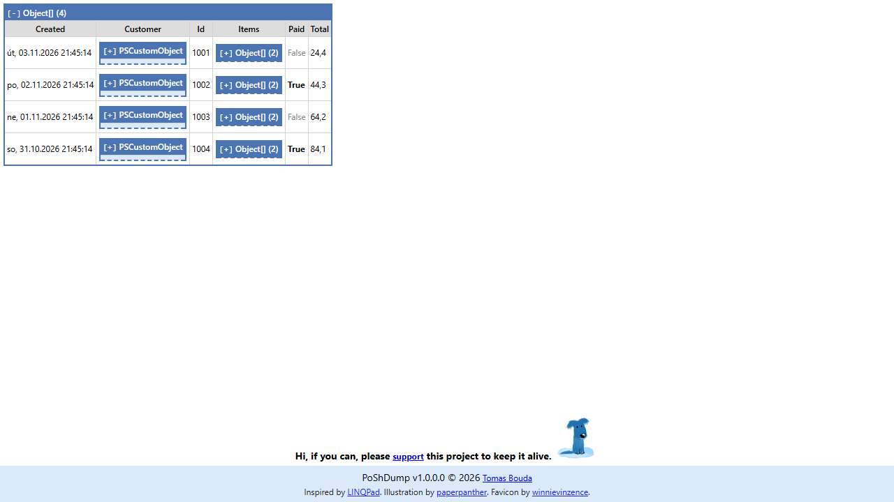

# PoShDump

[](https://www.powershellgallery.com/packages/PoShDump)
[](https://www.powershellgallery.com/packages/PoShDump)
[](https://github.com/TomasBouda/PoShDump/actions/workflows/build.yml)
[](LICENSE)

**Pipe any object to `Out-Dump` and get an interactive HTML page you can expand, search, keep and send to
somebody else.** `Format-List` scrolls away, `Export-Csv` flattens the nesting, and `ConvertTo-Json` turns a
process into a wall of text. A dump keeps the structure and stays readable a week later, when the incident is
being written up.



## Install

PoShDump is on the [PowerShell Gallery](https://www.powershellgallery.com/packages/PoShDump):

```powershell
Install-Module PoShDump -Scope CurrentUser
```

For local development:

```powershell
.\Build.ps1
Import-Module .\output\PoShDump\PoShDump.psd1 -Force
```

## Usage

Create an HTML dump in the default temp directory:

```powershell
Get-Process | Select-Object -First 10 | Out-Dump
```

Create a dump in a specific folder:

```powershell
Get-Service | Out-Dump -OutputDirectory .\dumps -Title 'Services'
```

Create a dump and open it in the default browser:

```powershell
Get-ChildItem $HOME | Out-Dump -Depth 3 -Show
```

`Out-Dump` passes input objects through the pipeline, so it can be dropped into an existing command without
changing what the command returns:

```powershell
Get-Service | Out-Dump | Where-Object Status -eq 'Running'
```

## Parameters

| Parameter | Description |
| --- | --- |
| `-Depth` | Controls how deeply nested objects are expanded. Default: `2`. |
| `-Title` | Sets the generated HTML page title. |
| `-OutputDirectory` | Folder where `dump-*.html` is written. Default: temp folder under `TomLabs\PoShDump`. |
| `-ResourcesDirectory` | Overrides the CSS/JS resource folder. Mostly useful for development. |
| `-Show` | Opens the generated HTML file with the operating system default application. |

The alias `dmp` is registered for `Out-Dump`.

## Good to know

- **A dump is a single self-contained file.** No CDN, no external JavaScript, nothing loaded when it is opened,
  so it works on an air-gapped server and still works in a year.
- **It runs on Windows PowerShell 5.1 and PowerShell 7**, on Windows, Linux and macOS.
- **A dump contains whatever you piped into it.** Secrets in the objects end up in the HTML in plain text -
  read it before you attach it to a ticket. See [SECURITY.md](SECURITY.md).

## Build, test, publish

```powershell
.\Build.ps1
.\Test-PoShDump.ps1
.\Publish.ps1 -NuGetApiKey '<your-gallery-api-key>' -WhatIf
```

Remove `-WhatIf` only when the preview output looks right. Every push and pull request on `master` is built and
tested by [GitHub Actions](.github/workflows/build.yml); `azure-pipelines.yml` does the same on Azure
DevOps and publishes to the PowerShell Gallery for tags starting with `v`.

## Contributing

Issues and pull requests are welcome - see [CONTRIBUTING.md](CONTRIBUTING.md). Architectural decisions are
recorded in [docs/decisions](docs/decisions/README.md); PoShDump is open core, which
[ADR 0001](docs/decisions/0001-open-core-distribution.md) explains.

## Credits

Inspired by [LINQPad](https://www.linqpad.net/)'s object dumper. Illustration by
[paperpanther](https://www.paperpanther.ie/), favicon by
[winnievinzence](https://www.flaticon.com/authors/winnievinzence).

## License

MIT. See [LICENSE](LICENSE).
